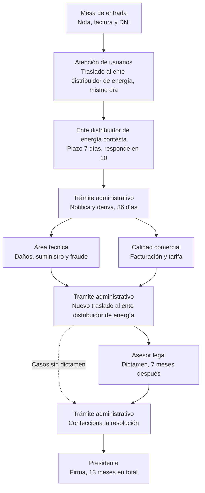
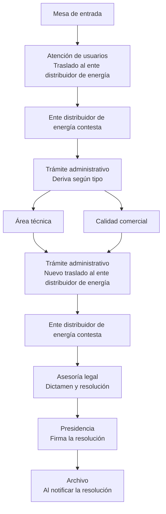

# Flujo de expedientes de reclamos – Entidad

Entidad reguladora de servicios públicos
Período analizado: expedientes 2023 – 2026

---

## 1. Alcance y fuentes

El flujo se construyó combinando tres fuentes:

- **Entrevistas** con el personal del ente, que dieron el modelo de circuito.
- **Listado de reclamos** (`reclamos.csv`): 1.611 reclamos de 2023 a 2026, con fecha de recepción, tipo de reclamo y traslado al ente distribuidor de energía.
- **Movimientos de expedientes** (`movimientos.csv`): 7.411 movimientos correspondientes a 1.588 expedientes. Todos tienen su reclamo en el listado; 23 reclamos todavía no registran movimientos.

Criterios aplicados:

- **Normalización y pérdidas y Área técnica se consideran una sola área** (Área técnica), que incluye los casos de fraude.
- Los nombres de áreas y los códigos de reclamo, escritos de muchas formas distintas en los archivos, se unificaron.
- Los tiempos se expresan como **mediana** (el valor del medio), salvo que se indique otra cosa.

---

## 2. Flujo

### Etapas

| # | Etapa | Qué hace | Tiempo |
|---|-------|----------|--------|
| 1 | Mesa de entrada | Recibe el reclamo con nota, copia de factura del ente distribuidor de energía y DNI | Día 0 |
| 2 | Atención de usuarios | Corre el traslado al ente distribuidor de energía por Nota A.U. | Mismo día de la recepción |
| 3 | Ente distribuidor de energía contesta | Responde el traslado | Plazo de 7 días; responde en 10 |
| 4 | Trámite administrativo | Notifica al usuario la respuesta del ente distribuidor de energía y deriva según el tipo de reclamo | 36 días hasta que el expediente llega al área |
| 5a | Área técnica | Informe técnico, pericias e inspecciones conjuntas con el ente distribuidor de energía. Incluye fraude (Normalización y pérdidas) | 85 días por paso |
| 5b | Calidad comercial | Análisis de facturación, tarifa y cobros | 19 días por paso |
| 6 | Trámite administrativo | Corre un nuevo traslado al ente distribuidor de energía con el informe del área | Ente distribuidor de energía tarda 26 días por respuesta |
| 7 | Asesor legal | Emite el dictamen | 7 meses desde el informe del área hasta el dictamen |
| 8 | Trámite administrativo | Confecciona la resolución | 84 días |
| 9 | Presidente | Firma la resolución final | 13 meses en total desde la recepción (casos con dictamen) |

**Camino sin dictamen (línea punteada):** algunos expedientes pasan del área directo a la resolución, sin intervención de Legal. Ocurre sobre todo en fraude (F-17) y suministro. Estos casos llegan a la firma en unos 76 días (2,5 meses); en fraude, unos 63 días.

**Inspecciones conjuntas:** se realizan con personal del ente distribuidor de energía, especialmente en reclamos por daños, baja tensión o sobrefacturación.

---

## 3. Derivación por área

| Área | Expedientes que pasan por ella |
|------|-------------------------------|
| Área técnica (incluye Normalización y pérdidas) | 81% |
| Calidad comercial | 12% |
| Ambas áreas | 6% |
| Ninguna de las dos | 13% |

Legal interviene en el 30% de los expedientes, Presidencia en el 21% y solo el 16% llega a Archivo.

---

## 4. Circuito por tipo de reclamo

| Tipo de reclamo | Expedientes | Área técnica | Calidad comercial | Legal | Presidencia | Archivo |
|-----------------|------------:|-------------:|------------------:|------:|------------:|--------:|
| F-17 Cobro de suma indebida | 523 | 85% | 19% | 6% | 17% | 13% |
| O-03 Daños y resarcimientos | 261 | 97% | 0% | 77% | 19% | 14% |
| S-10 Baja tensión | 221 | 93% | 0% | 5% | 23% | 6% |
| F-16 Sobrefacturación | 192 | 64% | 32% | 52% | 19% | 18% |
| S-07 Demora en conexión | 179 | 57% | 0% | 34% | 35% | 37% |
| S-12, S-05, S-17 Calidad, cortes y remociones | 102 | 93% | 0% | 19% | 14% | 12% |
| F-10, F-05 Cambio de tarifa y error de facturación | 83 | 65% | 33% | 42% | 25% | 19% |
| F-14 Impugnación de acta | 6 | 83% | 0% | 0% | 17% | 17% |

Los tipos se agrupan en tres familias de circuito:

- **Fraude y recupero de energía (F-17, F-14):** van al Área técnica y rara vez llegan a Legal.
- **Técnicos con dictamen (O-03, F-16):** informe del área, segundo traslado al ente distribuidor de energía y dictamen legal. Es el circuito más largo; en daños, el tiempo total hasta la firma es de unos 15 meses.
- **Técnicos sin dictamen (S-10, S-07 y resto de S):** van a Técnica y casi nunca llegan a Legal. En baja tensión, 1 de cada 4 expedientes pasa por Presidencia antes que por Técnica.

**Sobrefacturación:** aunque corresponde a Calidad comercial, en los datos el 64% pasa por el Área técnica. En 2025 fueron 39 expedientes a Técnica y 7 a Comercial. Conviene aclarar el criterio de derivación con las áreas.

---

## 5. Demoras del Área técnica

| Indicador | Valor |
|-----------|-------|
| Mediana por paso (casos que salieron del área) | 85 días |
| 10% más lento | más de 629 días |
| Pasos de más de 90 días | 49% de los casos, 90% de los días acumulados |
| Daños (O-03) | 186 días por paso |
| Con pericia / sin pericia | 66 / 86 días |
| Primer ingreso / reingreso | 107 / 38 días |

**Expedientes parados:** 651 pasos por el área no tienen movimiento posterior, y 478 de ellos llevan más de un año sin movimiento. Se concentran en fraude (F-17, 321) y baja tensión (S-10, 150). Es probable que muchos estén resueltos en los hechos pero sin cierre formal.

---

## 6. Dónde se pierde el tiempo

- Hasta la derivación al área el circuito es ágil: poco más de un mes y medio.
- Entre el informe del área y el dictamen legal pasan unos 7 meses (segundo traslado al ente distribuidor de energía, pericias e ida y vuelta por Trámite administrativo).
- Del dictamen a la firma pasan unos 5 meses; de eso, 84 días corresponden a la confección de la resolución en Trámite administrativo.
- Trámite administrativo concentra, junto con la espera de las respuestas del ente distribuidor de energía, el 41% del tiempo total de los expedientes.
- Hay 226 expedientes que volvieron de Legal a Trámite administrativo y no tuvieron otro movimiento: tienen dictamen pero no resolución registrada.

---

## 7. Mejora propuesta: la resolución la redacta Asesoría legal

El circuito se mantiene igual, con un único cambio: Asesoría legal entrega el dictamen junto con la resolución, y el expediente pasa directo a Presidencia para la firma.

**Impacto esperado:**

- Se elimina el paso de 84 días por Trámite administrativo entre el dictamen y la firma.
- Los casos con dictamen pasarían de unos 13 meses a unos 10.
- Los 226 expedientes con dictamen y sin resolución quedarían a cargo de Legal, que ya conoce el caso.
- La permanencia en Legal (hoy 41 días) va a aumentar, aunque mucho menos de lo que se ahorra, sobre todo si se trabaja con modelos de resolución por tipo de reclamo.

---

## 8. Otras mejoras posibles

1. **Pases directos entre áreas**, sin volver siempre a Trámite administrativo (cada paso suma 14 días).
2. **Revisar el segundo traslado al ente distribuidor de energía:** hacer la inspección conjunta al inicio, con acta firmada por el ente distribuidor de energía, o fijar un plazo con vencimiento automático. Requiere revisión legal por el derecho de defensa de la distribuidora.
3. **Clasificar el reclamo tras la primera respuesta del ente distribuidor de energía:** casos ya resueltos (archivo con conformidad del usuario), casos sin dictamen y casos con dictamen.
4. **Firma en lote** semanal en Presidencia; delegación de firma de resoluciones simples si la normativa lo permite.
5. **Plazos internos por tipo** en el Área técnica, con alerta de vencimiento (por ejemplo, a los 60 días).
6. **Cierre automático:** archivar el expediente al notificarse la resolución.

---

## 9. Calidad de los datos

- Las áreas aparecen escritas de más de 60 formas distintas; se recomienda una lista desplegable.
- Las fechas vienen en dos formatos mezclados; 61 movimientos no tienen fecha.
- La columna DIFERENCIA vale siempre 0 y las observaciones están vacías en la mayoría de los movimientos.
- El 94% de los reclamos tiene Cod_Estado = 12; falta la tabla de estados para interpretar los códigos.
- Mesa de entrada no registra movimientos en el sistema: el primer movimiento es la respuesta del ente distribuidor de energía en el 95% de los expedientes.
